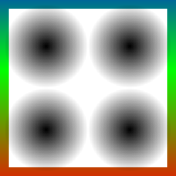
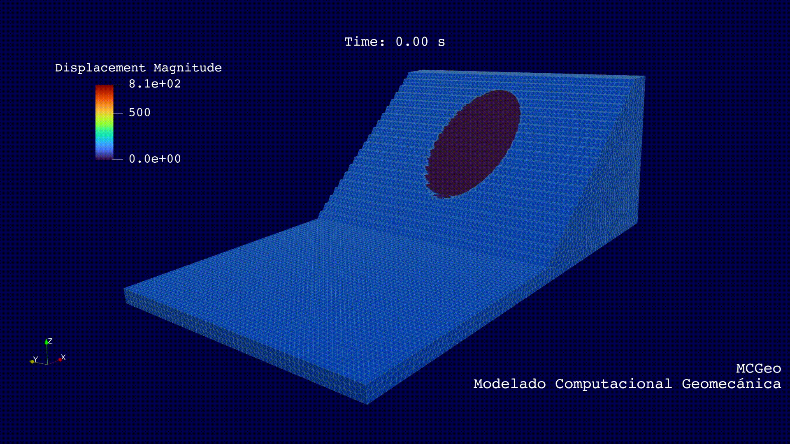
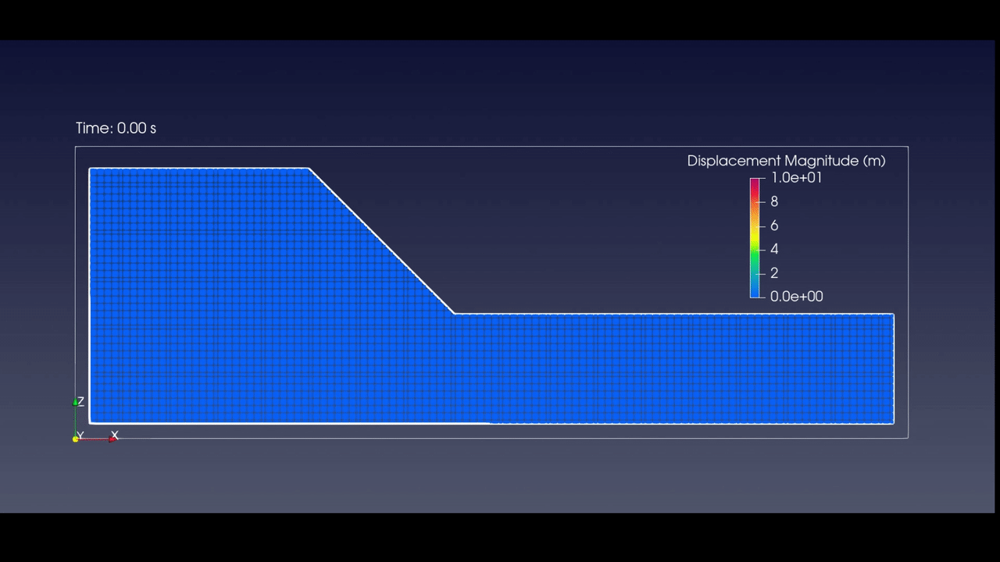
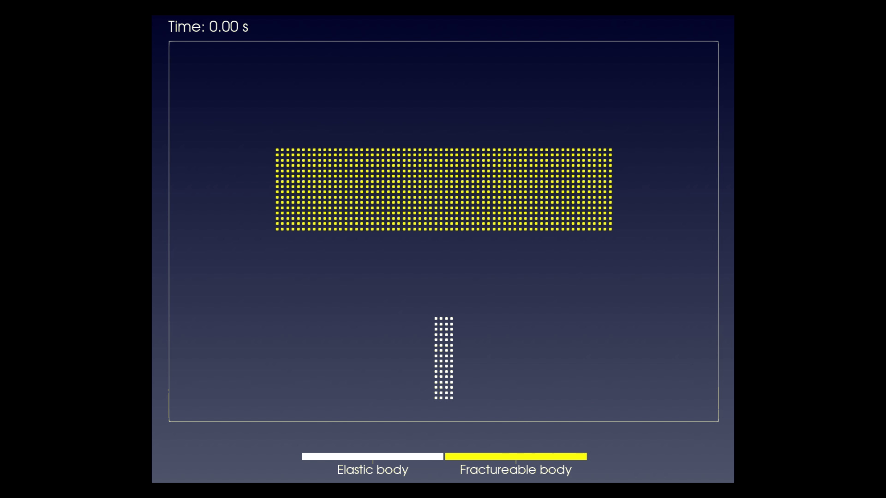
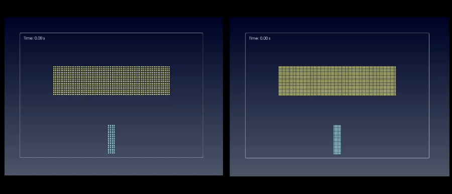

<div style="display: flex; align-items: center; gap: 16px; margin-bottom: 16px;">
  <div>
    <picture>
      <source media="(prefers-color-scheme: dark)" srcset="manual/latex/figures/mpm-geomechanics-icon-dark.png">
      <source media="(prefers-color-scheme: light)" srcset="manual/latex/figures/mpm-geomechanics-icon-light.png">
      
    </picture>
  </div>
  <div>
    <h1 style="margin: 0; padding: 0; border: none; font-size: 24px; line-height: 1.2;">MPM-Geomechanics</h1>
    <p style="margin: 2px 0 0 0; padding: 0; font-size: 13px; line-height: 1.2;"><em>An open-source simulator for large-deformation geomechanics</em></p>
  </div>
</div>

[](https://github.com/fabricix/MPM-Geomechanics/actions/workflows/c-cpp.yml)
[](https://github.com/fabricix/MPM-Geomechanics/actions/workflows/msbuild.yml)
[](https://github.com/fabricix/MPM-Geomechanics/actions/workflows/cmake-linux.yml)
[](https://github.com/fabricix/MPM-Geomechanics/actions/workflows/cmake-windows.yml)
[](https://github.com/fabricix/MPM-Geomechanics/actions/workflows/doxygen.yml)

## Motivation

MPM-Geomechanics is a program that allows us to model the behavior of geo-materials, like soil and rock, when these materials are subjected to different initial and boundary conditions. Currently, the geo-materials are present in several areas of the society, like for example in the slopes and excavation process in mining industry activities, or in the study of risk associated to naturals disasters.

The objective of this repository is to provide a platform for developing the MPM for the study of geomechanical problems involving large deformations and distortions.

## Collaboration

If you are interested to collaborate with this project, please contact to contact@mpmgeomechanics.com. There are several topics for developing in this project, here there are a few of them:

- Advanced unsaturated constitutive model for clay and sand (CASM-X) [(Bui et al.,2008)](https://doi.org/10.1002/nag.688)
- Contact method for large terrain models using STL meshes [(Zhang et al., 2023)](https://www.sciencedirect.com/science/article/abs/pii/S0266352X23001684) :white_check_mark:
- Penalty method for avoiding any penetration in STL meshes :white_check_mark:
- One direction hydro-mechanical coupling :white_check_mark:
- Explicit fully hydro-mechanical coupling :white_check_mark: [(Liu et al., 2017)](https://doi.org/10.1016/j.powtec.2017.02.022
)
- Axisymmetric formulation [(Nairn & Guilkey, 2015)](https://www.cof.orst.edu/cof/wse/faculty/Nairn/papers/AxisymGIMP.pdf)
- Implicit [(Nair & Roy, 2012)](https://doi.org/10.1080/15376494.2010.550082) and semi-implicit [(Kularathna et al., 2021)](https://doi.org/10.1002/nag.3207) time integration
- Convected particle domain interpolation [(Sadeghirad et al., 2011)](https://onlinelibrary.wiley.com/doi/10.1002/nme.3110)
- Thermo-mechanics formulation [(Zhan et al., 2024)](https://ui.adsabs.harvard.edu/link_gateway/2024CGeot.17006313Z/doi:10.1016/j.compgeo.2024.106313)
- Update stress schemes USF :construction:, USL :white_check_mark: and MUSL :white_check_mark: [(Buzzi et al., 2008)](https://www.newcastle.edu.au/__data/assets/pdf_file/0015/22236/Caveats-on-the-implementation-of-the-generalized-material-point-method.pdf)
- Damage constitutive models [(Homel & Herbold, 2016)](https://onlinelibrary.wiley.com/doi/abs/10.1002/nme.5317)
- Viscous constitutive models
- Critical state constitutive models [(Sheng et al., 2000)](https://www.newcastle.edu.au/__data/assets/pdf_file/0015/22560/45_Aspects-of-finite-element-implementation-of-critical-state-models.pdf)
- MPI implementation for process optimization [(Ku & Kim, 2023)](https://doi.org/10.1007/s40571-022-00480-y)
- ...

## Program features

The main features of the program in the actuality are:

- Three-dimensional formulation
- Dynamic formulation suitable for earthquake and general dynamic problems.
- Shared memory parallelization for computational time reduction
- Several constitutive models for soils and rock, including softening and hardening options.

## Documentation and Compilation

To generate the documentation locally with **Doxygen**, run the following command from the project root:

```bash
doxygen Doxyfile
```
The documentation will be saved in the `/docs/` folder, with the main entry point at: `/docs/index.html`. You can open this file in any web browser. For the online documentation, visit: [MPM-Geomechanics](https://fabricix.github.io/MPM-Geomechanics/)

## Compiled binaries

1. Go to the [Actions page](https://github.com/fabricix/MPM-Geomechanics/actions).
2. Select the latest run of the **MSBuild** workflow for Window, or **CI** for Linux.
3. At the bottom, you will find the available artifacts under the **Artifacts** section.
4. Download the `compiled-binaries` artifact to get the compiled code.

## Examples

### Simple mine slope failure
In this example we show the use of an STL mesh for modelling the topography and material points for representing the failed mass.



See the input file [mine-slope.json](https://github.com/fabricix/MPM-Geomechanics/blob/main/examples/mine-slope/mine-slope.json) inside to the example folder.

### Slope failure

In this example an soil slope failure is simulated using an elastoplastic material:



For more details of this simulation see the input file [slope-failure.json](https://github.com/fabricix/MPM-Geomechanics/blob/main/tests/slope-failure/slope-failure.json)

### Exponential softening model to simulate fracturing process in rock

#### Example 1:

Fracturing induced by exponential softening over the tensile strength. The yellow body is subjected to an initial velocity. The withe body is elastic.


An elasto-plastic body impacts over an elastic body. The exponential softening used over the tensile strength, in order to reproduce the fracturing process in the body.

See [exponential-softening.json](https://github.com/fabricix/MPM-Geomechanics/blob/main/tests/exponential-softening/exponential-softening.json) input file for simulation details.

#### Example 2

In this example is tested the refinement mesh behavior. The fixed (left-bottom) and free boundary (right-up) conditions are tested too.



See [exponential-softening-refined.json](/examples/exponential-softening/refined%20mesh%20test/exponential-softening-refined.json) input file for simulation details.

## Contributing

The way to contribution is to clone the repo and submit pull requests from your branches. If you are an external contributor, please fork the repository and submit a pull request from your fork.

## Disclaimer of Liability

This simulator is provided for academic and research purposes. It is distributed "as is", without any warranties of any kind, express or implied, including but not limited to warranties of merchantability or fitness for a particular purpose.

The use of this simulator and the interpretation of its results are the **sole responsibility of the user**. The developers and the affiliated institution shall not be held liable for any direct or indirect damages, economic losses, or consequences resulting from the use of this software.
